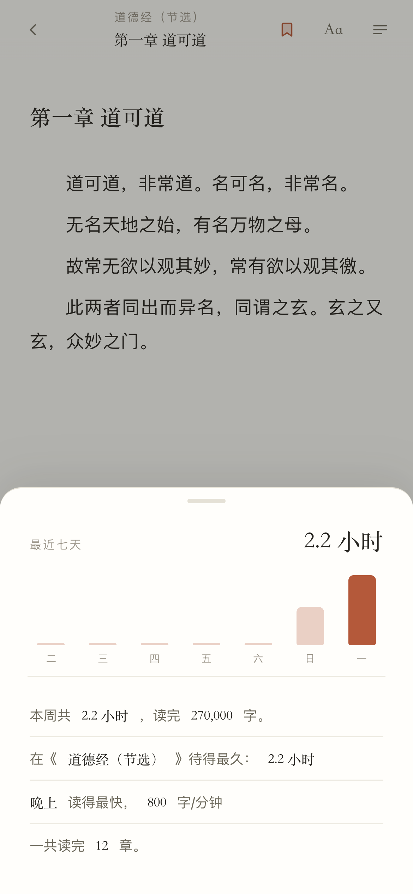
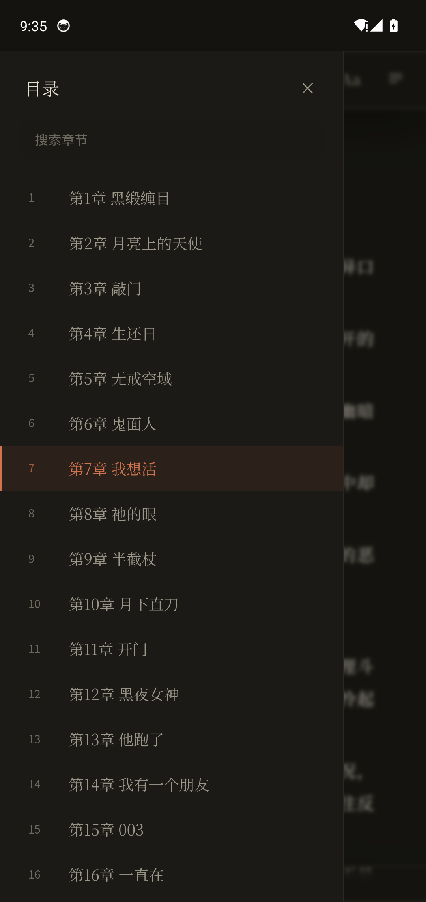
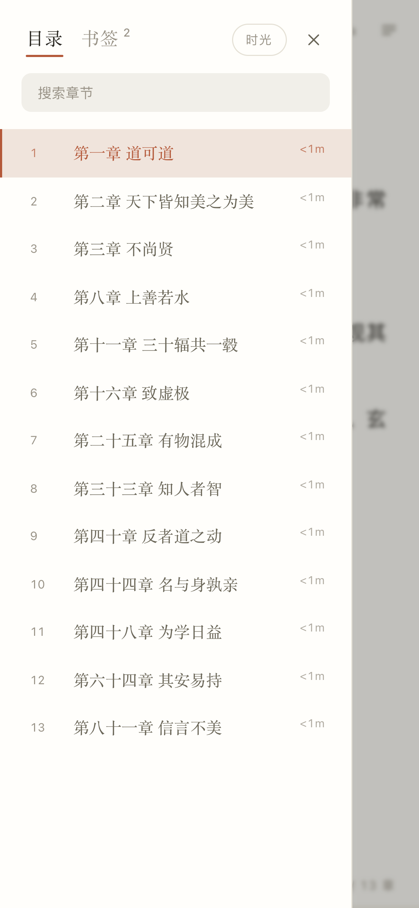
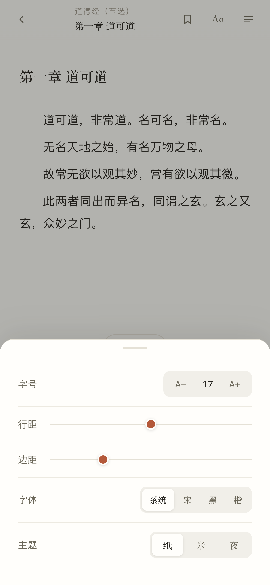

# 阅 · Reader

一个极简的中文 TXT 阅读器。Claude 式的克制审美、纯本地、零联网，内置「阅读时间引擎」。

Android 6.0+ 可直接安装，也可以直接在浏览器里打开网页版。


---

## 特性

### 阅读

- **书库** — 书架列表、字数、上次读到第几章
- **正文排版** — 宋体栈（打包内置 Noto Serif SC 子集）、首行缩进 2em、两端对齐、17px / 行高 1.88
- **三主题** — 纸 / 米 / 夜，状态栏同步变色
- **版式面板** — 字号 13–28、行距、边距、宋/黑/楷三体，实时生效并记忆
- **目录** — 全文分章、即时搜索、当前章高亮
- **书签** — 顶栏一键标记，记录章节 / 字符位置 / 添加时间 / 原文摘录；侧栏书签页一键跳回
- **字体** — 系统字体（PingFang SC / 微软雅黑 / system-ui）· 宋 · 黑 · 楷，字号 13–28、行距、边距均可调
- **进度** — 每本书独立记忆章节与滚动位置

### 阅读时间引擎

不是估数字，是越读越准。

**1. 冷启动**
没有历史数据时用 `550 字/分钟` 兜底，底栏时间显示为灰色，表示"还没校准"。

**2. 动态拟合**

| 机制 | 规则 |
|---|---|
| 采样单位 | 每次滚动的"停留字数" `dy / total × 屏内字数`，回滚不计 |
| 成样条件 | 累计满 60 秒才落一个 `[字数, 毫秒]` 样本 |
| 防挂机 | 相邻滚动间隔 > **2 分钟** → 本轮作废重来 |
| 噪声过滤 | 样本 < 2 秒、< 120 字、折算速度 < 60 或 > 4000 字/分，一律丢弃 |
| 平滑 | 最近 **8** 个样本线性加权（越近权重越高），结果夹在 120–2200 |

**3. 预估**

```js
本章剩余 = (本章字数 - 已读字数) / wpm
全书剩余 = (全书字数 - 全局已读字数) / wpm
```

**4. 三处呈现**

- **底栏标签** — 左下角，点一下循环切换：`本章还需 3 分钟` ↔ `全书 约 12 小时` ↔ `558 字/分`
- **目录时间** — 每章标题右侧标注 `4m`，睡前翻目录一眼决定读到哪一章
- **章末小结** — 读完后在章末按钮上方淡入：

  > 你用 **4 分 20 秒** 读完了本章，比平常快 **15%**
  > 高能章节真上头

  快 25% 以上给"上头"，慢 30% 以上给"值得回味"，其余只报数据。


### 附加小功能

- **深夜续航** — 凌晨 1–5 点开章，若本章还需 10 分钟以上，底部浮现一枚胶囊提醒，9 秒后自动消失，不挡操作
- **阅读时光** — 目录右上角「时光」，七天柱图 + 轨迹文案：本周时长 / 读得最久的一本 / 读得最快的时段与速度 / 读完章数



---

## 截图

| 书架 | 阅读 | 夜间 |
|---|---|---|
|  |  |  |

| 目录耗时 | 章末小结 | 阅读时光 |
|---|---|---|
|  |  |  |

| 书签 | 字体设置 | 空书架 |
|---|---|---|
|  |  |  |

---

## 项目结构

```
.
├── app/
│   ├── web/                    # 前端（纯 HTML/CSS/JS，无框架无构建）
│   │   ├── index.html
│   │   ├── style.css           # 三主题、玻璃坞、排版
│   │   ├── app.js              # 书库 / 分章 / 渲染 / 版式 / 目录
│   │   └── pace.js             # 阅读时间引擎（独立、可单测）
│   └── apk/                    # Android 外壳（WebView + assets）
│       ├── app/src/main/java/com/yue/reader/MainActivity.java
│       ├── app/src/main/res/   # 图标、主题、颜色
│       ├── build.sh            # 无 Gradle 的构建脚本
│       └── preview/            # 截图
└── books/                      # 放你自己的 .txt（不随仓库分发）
```

---

## 网页版运行

```bash
cd app/web
python3 -m http.server 8099
# 打开 http://127.0.0.1:8099
```

仓库里**只带一本公有领域示例**：`app/web/books/sample.txt`，《道德经》节选（老子，先秦，公版）。

想换成自己的书，改 `app/web/app.js` 顶部的数组：

```js
const BUILTIN = [
  { id: 'b-sample', title: '道德经（节选）', author: '老子 · 公版示例', file: 'books/sample.txt' },
  // { id: 'b-1', title: '书名', author: '作者', file: 'books/your-book.txt' },
];
```

或者直接把书架清空 —— 会看到「暂无书籍，点击下方导入」的空态。

导入的 TXT 存在 IndexedDB，长按书目可移除。

---

## 打包 APK

不需要 Gradle、不需要 Android Studio，纯命令行链：`aapt2 → javac → d8 → zipalign → apksigner`。

**前置**

| 依赖 | 说明 |
|---|---|
| JDK 17 | 任意发行版，脚本从 `$JAVA_HOME` 找 |
| Android SDK build-tools ≥ 34 | 提供 aapt2 / d8 / apksigner / zipalign |
| `android.jar` | 平台包，脚本里改路径指向 |

**步骤**

```bash
cd app/apk

# 1. 把前端和书放进 assets
cp ../web/index.html ../web/style.css ../web/app.js ../web/pace.js  assets/
mkdir -p assets/books assets/fonts
cp your-book.txt assets/books/yemu.txt
# 宋体子集放到 assets/fonts/serif.woff2 与 serif-bold.woff2

# 2. 改 build.sh 顶部三个路径
#    JDK=...  BT=...（build-tools）  AJ=...（android.jar）

# 3. 出包
./build.sh
# → yue-reader-1.0.apk
```

首次运行会自动生成自签证书 `keystore.jks`（口令 `yue2026`），产物已对齐并签名，可直接安装。

`app/apk/AndroidManifest.xml` 里 targetSdk 是 34、minSdk 23。

---

## 技术说明

**WebView 里怎么读本地书**

页面通过 `WebViewAssetLoader` 风格的自定义拦截加载：

```java
shouldInterceptRequest → https://appassets.androidplatform.net/…
                       → getAssets().open(rel) 流式返回
```

所以前端可以用普通的 `fetch('books/yemu.txt')`，不受 `file://` 同源限制。

**字体**

Noto Serif SC 的中文子集约 3MB（400/600 两档），覆盖约 4900 个常用汉字。生僻字回落系统字体。

**没有 color-mix 的旧 WebView**

样式里所有 `color-mix()` 前面都写了一条 `rgba()` 兜底，Chrome < 111 走退化值，功能不受影响。

**书签怎么定位**

渲染正文时给每个 `<p>` 打上 `data-off`（段首在全书中的字符偏移），书签存的就是这个偏移：

```js
{ off: 69, ch: 0, chTitle: "第一章 道可道", quote: "故常无欲以观其妙…", at: 1793586083830 }
```

同一段落内不会重复加书签（比较 `data-off` 精确相等），跳转后命中的段落会闪一下高亮。全存在 `localStorage` 的 `reader.bookmarks.v1`。

**状态栏跟随主题**

前端改主题时调 `NativeBridge.setTheme(name, bg, dark)`，原生侧 `setStatusBarColor` + `LIGHT_STATUS_BAR` flag。

---

## 许可

代码 MIT。书籍内容版权归原作者与出版方所有，本仓库不包含任何书籍正文。
